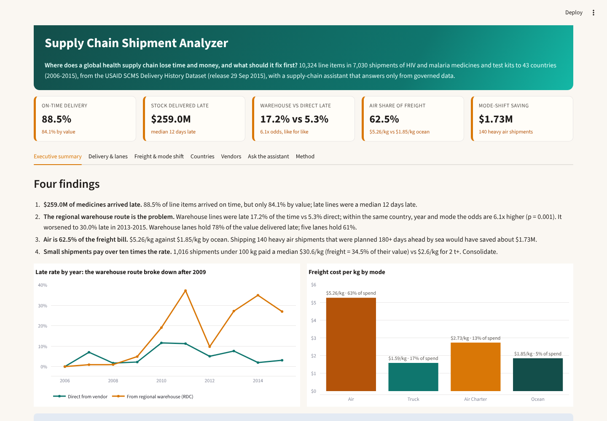
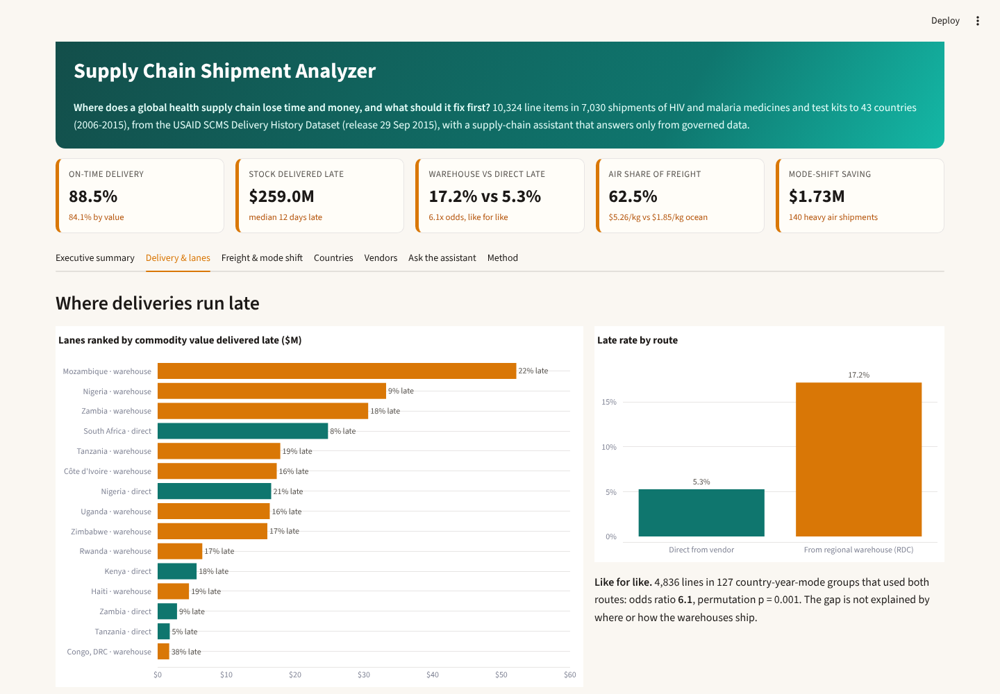
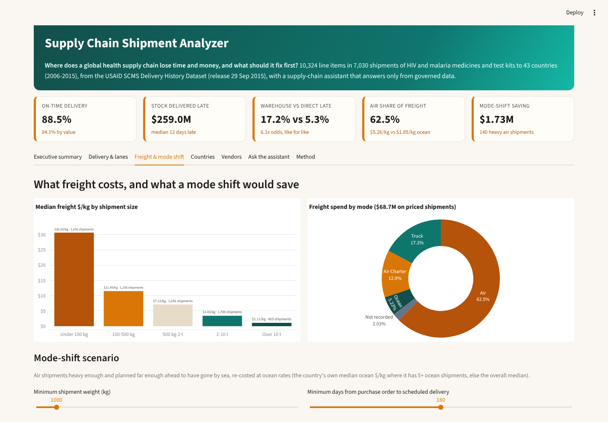

# Supply Chain Shipment Analyzer

[](https://github.com/Tanzil-Ali-Rizvi/supply-chain-shipment-analyzer/actions/workflows/ci.yml)


**Where does a global health supply chain lose time and money, and what should it fix first?** An analysis of the USAID Supply Chain Management System (SCMS) delivery history: 10,324 line items in 7,030 shipments of HIV and malaria medicines and test kits to 43 countries, 2006-2015, worth $1.63B, with $68.7M of recorded freight. It includes a ranked lane work list, a mode-shift scenario, a one-page brief per country, a Tableau dashboard, and a supply-chain assistant that answers only from governed data.



## What problem this solves

**The problem.** A procurement and logistics programme ships life-saving medicines to dozens of countries through two routes: direct from the manufacturer, or from regional warehouses (RDCs). When stock arrives late, clinics run short; when freight is planned badly, money that could buy medicine is spent on air freight. Leaders see one on-time percentage and one freight bill, which hides *which route, which lanes and which shipping decisions* cause the loss.

**What this project does about it.**
- **Measures delivery in value, not just lines.** 88.5% of lines arrive on time, but only 84.1% of value: $259.0M of medicines arrived late.
- **Finds the route that fails, and proves it.** Warehouse lines are late 17.2% of the time vs 5.3% direct, and the gap holds like for like (same country, year and mode: 6.1x the odds, permutation p = 0.001).
- **Ranks where to act.** Country × route lanes ranked by value delivered late; five lanes hold 61% of it.
- **Prices the freight decisions.** Cost per kg by mode and shipment size, and a scenario for moving heavy, early-planned air orders to ocean ($1.73M on 140 shipments).
- **Flags data you should not trust yet.** 11.8% of shipments have no freight cost of their own, and 18.5% of deliveries were recorded late in the system.

**Who it is for:** a supply-chain director or head of logistics, a procurement agent's planning team, a donor programme's performance analyst, or a freight-forwarding manager.

**Questions it answers**

| Question | Answer from the data |
| --- | --- |
| How reliable is delivery? | 88.5% of line items on time, 84.1% by value; late lines run a median 12 days late |
| Which route fails? | Regional warehouses: 17.2% late vs 5.3% direct; 6.1x the odds within the same country, year and mode (p = 0.001) |
| Is it getting better or worse? | Worse for warehouses: 37.2% late in 2011 and 30.0% across 2013-2015, while direct improved to 3.9% |
| Where should we act first? | Mozambique, Nigeria and Zambia warehouse lanes: $116M of late stock; five lanes hold 61% of all late value |
| What does freight cost? | Air is 62.5% of the bill at $5.26/kg vs $1.85/kg ocean and $1.59/kg truck |
| Are small shipments wasteful? | Yes: 1,016 shipments under 100 kg paid a median $30.6/kg and freight was 34.5% of their value, vs $2.6/kg at 2 t+ |
| What would a mode shift save? | Air orders of 1 t+ placed 180+ days ahead by sea: about $1.73M on 140 shipments (thresholds adjustable) |
| Which vendors ship late? | Aurobindo (14.1% late, median 27 days) and Cipla (13.1%, 33 days) vs 5.3% for all direct shipments |
| Can I trust the numbers? | Every headline comes from one metrics layer; the Tableau extract reconciles to it and the memo is tested against it |

## The answer in 30 seconds

| Finding | Evidence |
| --- | --- |
| **$259.0M of medicines arrived late** | 88.5% of lines on time but 84.1% by value; median 12 days late |
| **The regional warehouse route is the problem** | 17.2% late vs 5.3% direct; odds ratio **6.1** across 127 country-year-mode groups (4,836 lines), permutation p = 0.001; warehouse lanes hold **78%** of late value |
| **Air is 62.5% of the freight bill** | $5.26/kg vs $1.85/kg ocean; 140 heavy air shipments planned 180+ days ahead would have saved about **$1.73M** by sea |
| **Small shipments pay over ten times the rate** | Under 100 kg: median $30.6/kg vs $2.6/kg at 2 t+ |

**Recommendation:** start a warehouse service recovery in Mozambique, Nigeria and Zambia (replenishment triggers, dispatch lead times, re-promising when short); make ocean the default for orders of 1 t+ placed 180+ days ahead; batch sub-100 kg orders per country. Full memo: [docs/findings.md](docs/findings.md).

## For analyst reviewers: the supply-chain analytics work

- **Real government data, handled at the right grain.** Freight and weight are recorded once per shipment and the other lines say "See ASN-xxx (ID#:yyy)"; all 2,445 references resolve inside the same shipment, so freight is analysed per shipment and delivery per line. Two public copies of the USAID release were compared cell by cell before use (identical apart from date formatting).
- **Supply-chain KPIs defined once** in [docs/kpi_definitions.md](docs/kpi_definitions.md): OTD by line and by value, value delivered late, lanes, freight $/kg, freight share of value, lead time and planning window.
- **Statistics that hold up.** The warehouse-vs-direct gap is tested like for like with a Mantel-Haenszel odds ratio within country × year × mode groups, and a permutation test that shuffles the route label within each group (1,000 shuffles, fixed seed).
- **A costed scenario, not just a chart.** The mode-shift estimate uses each country's own ocean rate where it has 5+ ocean shipments, never counts a shipment as cheaper by air, and states what it ignores (port capacity, inventory cost of longer transit).
- **Deliverables a supply-chain team uses:** a ranked lane work list, a vendor scorecard, a one-page brief per country, a findings memo and a Tableau dashboard.

### Tableau dashboard

Two dashboards: **Delivery & Freight Overview** (KPI row, late rate by year and route, top 12 lanes by value late, map of late rate by country, freight $/kg by mode) and **Freight, Vendors & Mode Shift** (cost per kg by shipment size, mode-shift saving by country, vendor scorecard).
- **Built as code.** [`tableau/build_workbook.py`](tableau/build_workbook.py) generates the workbook XML (datasources, calculated fields, worksheets, dashboards) and it is validated against Tableau's workbook schema before opening.
- **Governed data.** [`scripts/export_tableau.py`](scripts/export_tableau.py) writes the extract files from the same metrics layer and reconciles six headline numbers before writing; [`tableau/make_extracts.py`](tableau/make_extracts.py) turns them into Hyper extracts.
- **Tableau calculations** reproduce the Python KPIs (on-time rate, value late, warehouse vs direct late rate, air share of freight, freight $/kg).

### Streamlit app and country brief

| Delivery & lanes | Freight & mode shift |
| --- | --- |
|  |  |

## For AI engineering reviewers: the grounded supply-chain assistant

Ask *"Is the warehouse route slower than direct shipping?"*, *"How is Zambia doing?"*, *"What if air shipments over 2 t planned 150 days ahead went by sea?"* or *"How does Aurobindo perform?"*.

- **Typed tools, not free text.** Eight tools (OpenAI function schema, countries as an enum) wrap the governed metrics: network summary, route comparison, country profile, vendor profile, freight by mode, mode-shift scenario, lane work list and vendor search.
- **Entity and parameter resolution.** Country aliases (Ivory Coast, DRC), vendor names matched on distinctive words with the scored vendor preferred, and scenario thresholds parsed from the question ("over 3 t", "120 days ahead").
- **Two modes, same facts.** Offline, a deterministic planner chooses the tools. With an OpenAI-compatible model (Groq, Gemini, Ollama, or my [llm-gateway](https://github.com/Tanzil-Ali-Rizvi/llm-gateway)), the model chooses them through function calling.
- **Grounding check with fallback.** Any number in an answer that the tools did not return sends the assistant back to the template answer.

**Evaluation, gated in CI:**

| Check | Result | Gate |
| --- | --- | --- |
| Tool selection, build set | 24/24 | 95% |
| Tool selection, held-out set (written before running, never tuned) | 11/14 | reported |
| Answers and all 43 country briefs grounded in tool results | 81/81 | 100% |
| Tampered answers caught (every number altered) | 736/736 | 100% |
| Route claim: warehouse vs direct, same country, year and mode | odds ratio 6.1, p = 0.001 | p < 0.01 |

**Known limits (held-out misses, left visible rather than patched):**
- "Summarise delivery and freight performance" goes to the freight tool, not the network summary.
- "Is trucking cheaper than air?" is read as a mode-shift scenario because "cheaper" is a scenario keyword.
- "How late does Abbott ship?" picks Abbott GmbH, not AbbVie Logistics (formerly Abbott Logistics): a genuinely ambiguous name.
- 59 alterations that swapped a number for another value already in the tool results were skipped, because number matching cannot detect them.

## Run it

```bash
git clone https://github.com/Tanzil-Ali-Rizvi/supply-chain-shipment-analyzer
cd supply-chain-shipment-analyzer
pip install -r requirements-dev.txt
streamlit run app/streamlit_app.py       # dashboard + assistant, offline
pytest -q && python evals/run_evals.py   # tests, gated evals
python scripts/export_tableau.py         # rebuild and reconcile the Tableau extract files
python tableau/build_workbook.py --data-dir "<folder with the extracts>"
```

Optional: copy `.env.example` to `.env` and set `LLM_BASE_URL`, `LLM_API_KEY`, `LLM_MODEL` to let a model choose the tools.

## Repository layout

```
docs/          findings memo, KPI definitions, screenshots
src/shipiq/    data cleaning (DuckDB tables), metrics, route test, mode-shift scenario, tools, assistant, country brief
app/           Streamlit dashboard
tableau/       workbook generator, Hyper extract writer, extract CSVs
evals/         tool-selection sets (build + held-out), grounding, tamper, statistical claim gate
tests/         pytest suite, including a check that the memo quotes the computed numbers
scripts/       Tableau export with reconciliation
```

## Data and caveats

- **Source:** USAID, *Supply Chain Shipment Pricing Data* (SCMS Delivery History Dataset, release 29 Sep 2015), published on the USAID Development Data Library (data.usaid.gov, dataset `a3rc-nmf6`, catalogued on [catalog.data.gov](https://catalog.data.gov/dataset/supply-chain-shipment-pricing-data)). data.usaid.gov is no longer online, so the file in `data/raw/` is a public copy of that release (original file name and date kept); a second independent copy was compared cell by cell and matched apart from date formatting.
- **On time** means delivered on or before the scheduled date in the source; the data does not say whether a date was renegotiated.
- **Observational data:** the route comparison controls for country, year and mode, but not every reason an order went through a warehouse.
- **Scenario:** historical rates only; it ignores port capacity and the inventory cost of a longer transit.
